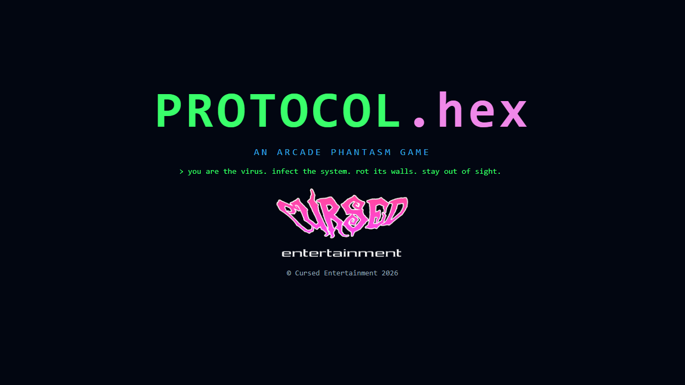
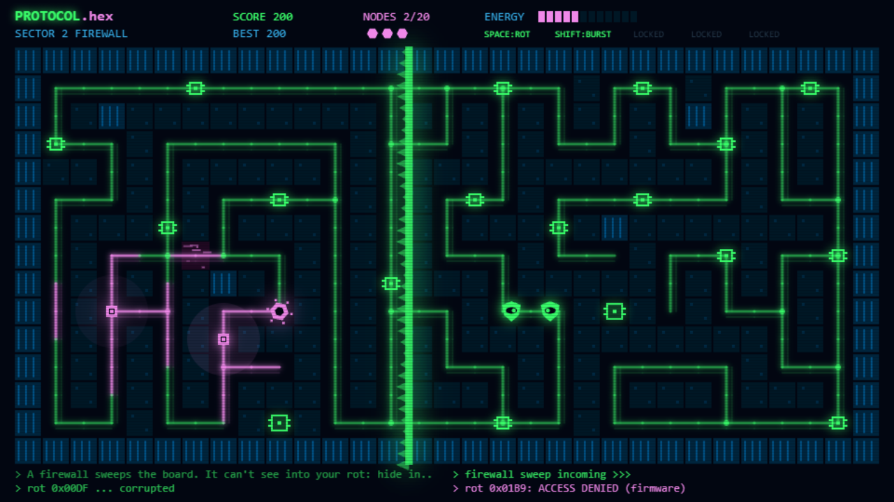

 

  

 

  
  
  

 

# PROTOCOL.hex

**An [Arcade Phantasm](https://arcade-phantasm.netlify.app/) game** · **[Play it](https://cursedprograms.github.io/ProtocolHex/)**

You're a virus loose inside a computer system. Slide along the glowing pathways of the circuit board, infect every node (each one turns pink and becomes yours) and keep away from the green antivirus programs that patrol the traces and chase you down. Your corruption bleeds pink through the green terminal system like a curse.

**The twist:** infection energy lets you corrupt the system itself. Rot a wall into a new pathway to break into a sealed vault, cut a shortcut, or escape a hunter. Rotted cells are yours: the firewall and the scanner can't see into them.

  
  
   
  

## Versions

- **Browser**: this one, right here at the repo root. [Play it](https://cursedprograms.github.io/ProtocolHex/).
- **Windows exe**: in `cpp/`: download `ProtocolHex-win64.zip` from the [latest release](https://github.com/CursedPrograms/protocol-hex/releases/latest), unzip, run `ProtocolHex.exe`.
- **Android**: in `android/`, the APK in [`android/apk/`](android/apk/). See [Android](#android) below.

## How to play

Infect every node in the sector to clear it. Each node gives infection energy (vault nodes give more); spend it to rot walls (2) and plant traps (3). Hardened firmware walls (the striped ones) can't be rotted. If an antivirus touches you, you lose a copy; clearing a sector gives one back. If you run dry, energy trickles back up to 4 on its own.

Each sector brings a new security system and unlocks a new ability:

| Sector | Security | You unlock |
|---|---|---|
| 1 Boot Sector | antivirus hunters | **Rot**: turn the wall ahead into a pathway |
| 2 Firewall | a wall of fire sweeps the board; hide in your rot | **Burst**: a short speed burst |
| 3 Quarantine | zones seal shut; get locked in and a guard spawns beside you | **Trap**: a puddle of corruption that snares antivirus |
| 4 Scanner | a radar beam reveals you to every antivirus at once | **Cloak**: pass as harmless data |
| 5 Honeypot | some nodes are traps (watch for a flickering ?) | **Split**: a copy that infects what it touches and draws fire |
| 6 System Restore | waves that undo your corruption; infect the four restore points to break it | |

Clear all six and the system reboots, faster, with more antivirus. Your best score is saved in the browser.

## Controls

| Key | |
|---|---|
| Arrows / WASD | move |
| Space | rot the wall ahead |
| Shift | speed burst |
| C | plant a trap |
| Q | cloak |
| F | split off a copy |
| P | pause |
| M | mute |

On a phone: swipe on the board to steer, tap to rot, and use the buttons on the right for the rest.

## Windows exe

C++17 with SDL2, OpenGL 3, [Dear ImGui](https://github.com/ocornut/imgui) and [stb](https://github.com/nothings/stb).
The same game as the browser one: the same six sectors (built from the same seeds, so the same boards), the same
security systems, abilities, scoring and sound effects (made as it plays, no audio files). Arrows / WASD move, Space rot,
Shift burst, C trap, Q cloak, F split, P pause, M mute, F11 fullscreen, Esc menu. Your best score is kept in your
user settings folder. `ProtocolHex.exe --shot` opens the staged moment from the Scanner sector.

To build it: Visual Studio 2022 (C++) and CMake, then `cpp/build.bat` (or `build.ps1`; `build.sh` on Linux with
SDL2 installed). It fetches SDL2 once into `cpp/external/`, builds `cpp/build/Release/ProtocolHex.exe` and packs
`cpp/dist/ProtocolHex-win64.zip`. The code: `cpp/src/main.cpp` (window, splash), `game.cpp` (rules, drawing),
`canvas.cpp` (a small canvas-like drawing layer over ImGui), `synth.cpp` (the sound effects).

## Android

The browser game in an Android app: it plays offline, full screen in landscape, with the sound on from the start
(Android 7.0 or newer).

- **Download**: the APK in [`android/apk/`](android/apk/). Copy it to the phone and open it (allow installs from
  unknown sources when asked).
- **Build it**: the Android SDK and JDK 17, then `android/build.bat` (or `build.ps1`, `build.sh`). It runs
  `gradlew assembleDebug` and leaves the APK in `android/apk/`. The game's web files are copied into the app at build
  time, so the browser game at the repo root stays the only copy.
- **The code**: `android/app/src/main/java/com/synthwomb/protocolhex/MainActivity.kt`, a full-screen WebView that serves the
  game from the app's assets. Press Back twice to leave.

## Files

- `index.html`: the page: the canvas, the splash, the touch buttons
- `site/style.css`: the page styling
- `site/game.js`: the game: sector generation, movement, antivirus, security systems, drawing, input
- `site/sfx.js`: the sound effects, made with Web Audio (no audio files)
- `images/`: the Cursed logo and the screenshots

Open `index.html#shot` for a staged moment from the Scanner sector.

## Also in the arcade

[KillerStardust](https://github.com/CursedPrograms/KillerStardust) · [ProtocolHex](https://github.com/CursedPrograms/ProtocolHex) · [Seance](https://github.com/CursedPrograms/Seance) · RicochetReaper · GraveDanger · Vortex · Orbit · RocksOfRuin · Devourer

 

© Cursed Entertainment 2026

 

